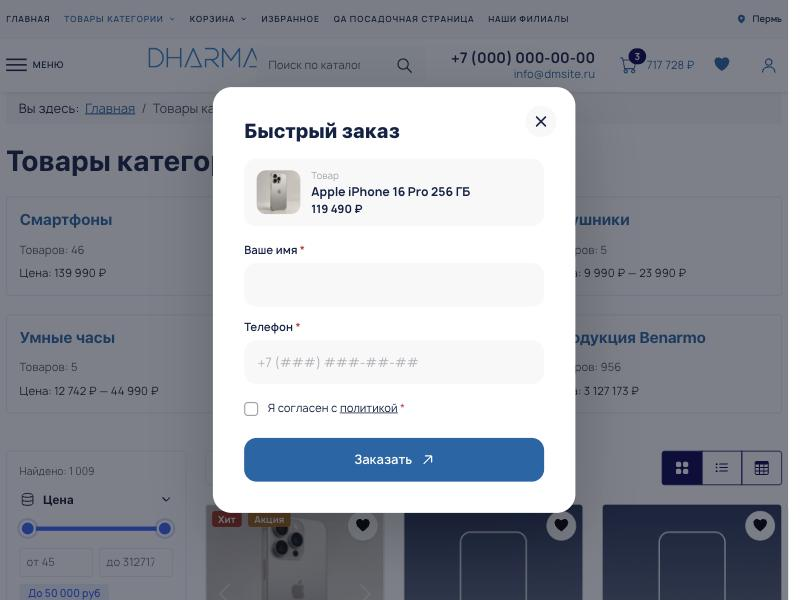
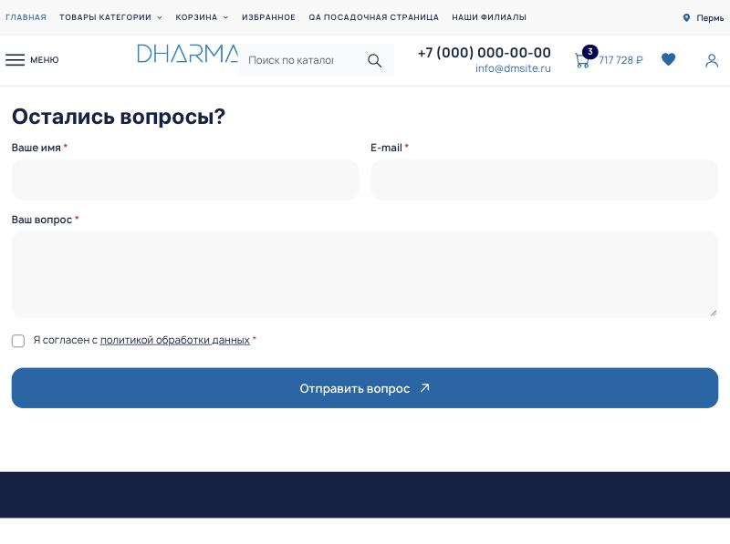

# Dharma Form

[](https://github.com/shivayanamahom/com_dharma_form/releases)
[](https://www.joomla.org/)
[](https://www.php.net/)
[](LICENSE.txt)

<!-- ai-notice -->
> [!NOTE]
> **О проекте.** Этот проект написан при помощи ИИ для моего собственного использования и опубликован «как есть» (*as is*). Он может содержать ошибки и подходить не для всех сайтов и версий Joomla. Гарантий, поддержки и сроков исправления я не обещаю. Перед использованием изучите код и проверьте его на тестовой копии сайта, всё на ваш риск. Идеи и замечания приветствуются (Issues, Pull Request), но отвечу и приму их не обязательно.
>
> *AI-assisted and built for my own use. Provided **as is**, without warranty or support. Review the code and test on a staging copy first; use at your own risk. Issues and PRs are welcome, but no response is guaranteed.*

<!-- /ai-notice -->

Универсальный компонент форм для Joomla: **конструктор** в админке, **приём заявок** со своей защитой от спама, **загрузка файлов**, **уведомления** на почту, в Telegram и MAX, журнал заявок и автопоказ всплывающих окон. Работает на любом сайте, без дополнительных модулей и без сторонних плагинов, на чистом JavaScript (без jQuery).

<p align="center">
  
  
</p>

## Быстрая установка

В Joomla: **Система → Установка → Расширения → Установить по URL-адресу**:

```text
https://github.com/shivayanamahom/com_dharma_form/releases/latest/download/pkg_dharma_form.zip
```

Также можно скачать версионный ZIP в [Releases](https://github.com/shivayanamahom/com_dharma_form/releases). Новые версии приходят штатным обновлением Joomla (**Система → Обновление → Расширения**). История изменений: [CHANGELOG.md](CHANGELOG.md).

После установки в меню админки появится **Dharma Form** с разделами **Формы**, **Заявки** и **Настройки**.

## Что в пакете

| Расширение | Назначение |
| --- | --- |
| `com_dharmaform` | Компонент: конструктор, приём, заявки, настройки |
| `plg_system_dharmaform` | Подключение скриптов только где нужно, шорткод `{dharmaform код}` |
| `plg_dharmaformnotify_email` | Канал уведомлений: почта (через почтовые настройки Joomla) |
| `plg_dharmaformnotify_telegram` | Канал уведомлений: Telegram |
| `plg_dharmaformnotify_max` | Канал уведомлений: MAX |
| `plg_task_dharmaform` | Задания планировщика: повтор неудачных отправок, очистка старых заявок |
| `plg_dharmashop_dharmaform` | Интеграция с Dharma Shop (товар в форме) |

Все плагины включаются при установке.

## Быстрый старт

1. **Формы → Создать.** Назовите форму, на вкладке **Поля** соберите поля, выберите **Тип формы** справа: *Всплывающая* или *Обычная*.
2. Вставьте форму на сайт ([способы ниже](#размещение-на-сайте)).
3. **Настройки → Уведомления:** включите почту, Telegram или MAX и нажмите **Отправить тест**.
4. Заявки появятся в **Заявки**; спам помечается отдельно и в уведомления не попадает.

## Возможности

### Конструктор форм
- Поля: **строка, e-mail, телефон с маской, текст, список, переключатели, флажки, дата, файлы, скрытое поле** (адрес или заголовок страницы, своё значение), **согласие** со ссылкой на политику (метка `{link}`), **блок текста** между полями.
- Обязательность, свой текст ошибки, ширина (на всю строку или половина), подсказка в поле.
- **Подписи над полями** или только подсказка внутри: для всей формы и отдельно для каждого поля.
- Куда в заявке попадает поле: имя, телефон, почта или сообщение определяются автоматически, остальное хранится по подписи.
- Настройки формы: заголовок и вступление окна, текст и класс кнопки, действие после отправки (сообщение, переход на страницу, закрытие окна), цели **Яндекс Метрики**, gtag и dataLayer.

### Размещение на сайте
- **Всплывающая форма** открывается по клику на любой элемент с классом: сам **код формы** работает как CSS-класс (например `callback`), также подходит `dharmaform-callback` и свои классы из настроек. Кнопка с атрибутом `data-dharmaform="код"` работает так же.
- **Обычная форма** вставляется шорткодом `{dharmaform код}` в материал, в модуль «Произвольный код» или в шаблон, либо отдельным пунктом меню **Форма**.
- Для всплывающей формы шорткод выводит кнопку: `{dharmaform код text="Позвонить"}`.
- Форма в окне подгружается заранее (при наведении на кнопку), поэтому открывается мгновенно.
- Макет формы переопределяется в шаблоне: `html/layouts/dharmaform/form.php`.

### Автопоказ всплывающих окон
Для каждой всплывающей формы: **по времени, по прокрутке, при уходе со страницы** (курсор к верху окна), **при бездействии**. Частота: раз за сеанс, раз в N дней или всегда; только компьютеры или только телефоны; на каких страницах показывать или не показывать (шаблоны путей с `*`); срок «не показывать после отправки». Тумблер **Режим разработчика** в настройках отключает все ограничения по показам для проверки.

### Защита от спама
Заявка набирает баллы за подозрительные признаки; по порогу она уходит в «спам», а посетитель видит обычное «принято». Работает на вашем сервере, без внешних капч.

| Сигнал | Что делает |
| --- | --- |
| Токен Joomla | Отправка без него отклоняется |
| Случайные поля-ловушки | Имя ловушки меняется при каждом показе |
| Подписанная метка с одноразовым номером | Подделку и повтор отправки видно сразу |
| Proof-of-work | Невидимая «капча»: браузер решает вычислительную задачу |
| Присутствие человека | Нужны реальные события в форме и время на заполнение |
| Слишком быстрая отправка, лавина заявок на форму, лимит по адресу | Лимит считается по IPv6-сети /64; при явной атаке заявка не записывается |
| Ссылки, стоп-слова, чужие алфавиты, «абракадабра», одноразовая почта, домен почты без MX | Баллы по содержимому |
| Чёрный и белый списки адресов | Адреса и сети (`10.0.0.0/8`) |

Причины и балл видны в карточке заявки. Форма на странице, попавшая в кэш, сама запрашивает свежие токен и метку.

### Загрузка файлов
- Белый список типов в настройках (по умолчанию: jpg, jpeg, png, gif, webp, pdf, docx, xlsx, pptx, odt, ods, txt, csv), в поле формы можно сузить список, задать размер и число файлов; режимы: кнопка или зона перетаскивания.
- Тип подтверждается **началом самого файла**, а не только расширением. Исполняемые и веб-форматы (php, html, js, svg, exe и другие) не принимаются никогда.
- Файлы лежат под **нейтральным расширением** `.dat` со случайными именами, в закрытой папке (по умолчанию `files/dharmaform`), и отдаются **только из админки** (нужны права).
- Для nginx закройте папку правилом: `location ~* ^/files/dharmaform/ { deny all; }`; лучше указать папку вне публичной части сайта.

### Уведомления
- **Почта** (HTML-письмо, ответ уходит заявителю, вложения), **Telegram** и **MAX**; свои получатели у каждой формы.
- Кнопка **Отправить тест** у каждого канала показывает результат по каждому получателю и понятную причину ошибки.
- **Журнал доставки** в карточке заявки, повтор при сбое с нарастающей паузой.
- Рассылка идёт после ответа посетителю: он не ждёт почту и мессенджеры.
- Свой канал: плагин группы `dharmaformnotify`, подписка на событие `onDharmaFormNotify`.

### Заявки
Список с фильтрами (форма, спам, прочитано, дата, поиск), карточка заявки со всеми полями, файлами и журналом доставки, пометки «спам» и «прочитано», **выгрузка в CSV**, срок хранения (общий, для формы и отдельно для спама) с автоматической очисткой.

### Данные о посетителе (по умолчанию выключены)
По переключателям в настройках: IP-адрес, браузер с системой и устройством, язык, откуда пришёл, размер экрана и часовой пояс. Для ограничения частоты адрес всегда хранится только необратимым хешем.

### Интеграция с Dharma Shop
Тумблер **Подцеплять товар Dharma Shop** на вкладке **Интеграции** формы: кнопка с классом формы в карточке или на странице товара открывает форму с товаром (картинка, название, цена). В заявку и уведомления попадают название, артикул, цена и ссылка. Товар ищется на сервере по базе магазина, подменить его в запросе нельзя.

### Скорость
- На страницах без форм грузится только лёгкий загрузчик (около 5 КБ в сжатом виде); стили и тяжёлая часть подгружаются при наведении на кнопку, клике или автопоказе.
- Proof-of-work считается при первом касании формы, а не при загрузке страницы; запрос форм из базы лёгкий.

## Настройки компонента

| Вкладка | Что настраивается |
| --- | --- |
| Общие | Адрес политики, адрес сайта для ссылок в уведомлениях, папка и типы файлов, срок хранения, данные о посетителе, режим разработчика, обновление токена форм |
| Уведомления | Каналы: получатели, токены ботов, что присылать, кнопки проверки |
| Защита от спама | Откуда брать адрес посетителя, чёрный и белый списки, общие стоп-слова, свои домены одноразовой почты |
| Права доступа | Штатные права Joomla, плюс «просмотр заявок» и «выгрузка заявок» |

## Для разработчиков

```text
com_dharmaform/            компонент (admin, site, media)
plg_system_dharmaform/     подключение скриптов, шорткод
plg_dharmaformnotify_*/    каналы уведомлений (email, telegram, max)
plg_task_dharmaform/       задания планировщика
plg_dharmashop_dharmaform/ интеграция с Dharma Shop
build.sh                   сборка пакета
```

- Сборка: `./build.sh` → `dist/pkg_dharma_form-<версия>.zip`.
- Релиз: **Actions → Build and publish Joomla update → Run workflow** (собирает пакет, дописывает `updates.xml` с контрольной суммой и создаёт релиз).
- События: `onDharmaFormNotify` (рассылка заявки каналам), `onDharmaFormContextResolve` (поиск объекта для привязки формы).
- Скрипты: `media/js/form.js` (загрузчик), `media/js/form-ui.js` (проверка, маска, файлы, защита), без зависимостей.

## Требования и совместимость

Joomla 5.2+ или 6, PHP 8.2+ с расширениями `fileinfo` и `curl` (или включённым `allow_url_fopen`). Проверено на Joomla 6.2 и PHP 8.4.

## Удаление

При удалении компонента таблицы заявок удаляются, а загруженные файлы остаются на диске (в них могут быть персональные данные): Joomla сообщит, в какой папке они лежат.

## Лицензия

GPL-2.0-or-later, см. [LICENSE.txt](LICENSE.txt).
